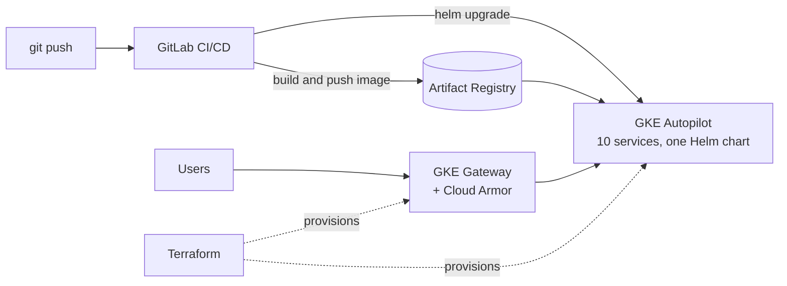

<h1 align="center">Hi, I'm Ahmar Rahmani</h1>

  

  
  
  

---

I'm a DevOps Intern at **BytePe**, a fintech startup, where I run services on **Google Cloud with Kubernetes**. I like infrastructure that's boring in production: reproducible with Terraform, shipped through pipelines, and visible in dashboards.

## What I work on at BytePe

| | |
| --- | --- |
| **VM → Kubernetes** | Migrated a 10-service backend from VMs to **GKE Autopilot** with my lead, all on one shared **Helm** chart |
| **Pipelines** | **GitLab CI/CD** to dev and a new staging environment, with migration Jobs, immutable image tags and automatic rollback |
| **Infrastructure as code** | **Terraform** for GKE Gateway, Cloud Armor, Workload Identity and IAM |
| **Cost** | About **64% fewer** non-production compute hours by scaling to zero outside working hours |
| **Reliability** | Tuned HPA autoscaling and health probes; **k6** load tests for the platform and its Cloud Armor rules |
| **AI infrastructure** | Self-hosted **NVIDIA Nemotron on vLLM** on a GKE GPU node, with a RAG proof of concept |

A simplified view of how a change ships:

BytePe's code lives in private company repositories. Everything below is my own.

## Featured project

### [docker-logging-stack](https://github.com/ehmerr/docker-logging-stack)

Collects logs from every Docker container into one place. **Grafana Alloy** discovers containers through the Docker socket, labels each stream by container name and ships it to **Loki**; **Grafana** searches it all with LogQL.

`Docker Compose` `Grafana` `Loki` `Grafana Alloy` `LogQL`

## Right now

- Setting up monitoring for our GKE platform with **Google Cloud Managed Service for Prometheus** and **Grafana**
- Preparing for **AWS Certified Cloud Practitioner** (December 2026)
- Learning **Argo CD** and GitOps

## Tech stack

**Cloud: Google Cloud**

**Containers & orchestration**

**Infrastructure as code**

**CI/CD & version control**

**Observability**

**Linux & networking**

**Databases**

**Languages**

**Testing & load testing**

**AI infrastructure**

**Learning**

## Other projects

- [Strandly](https://github.com/ehmerr/Strandly-Your-Friendly-Hair-Fall-Tracker): a full-stack MERN app for tracking hair fall and visualising trends
- [Cure Connect](https://github.com/ehmerr/DoctorAppointmentBookingSystem): doctor appointment booking, [live demo](https://cure-connect-nine.vercel.app)
- [MovieRecSystem](https://github.com/ehmerr/MovieRecSystem): content-based movie recommendations with cosine similarity
- [DSA_QUESTIONS](https://github.com/ehmerr/DSA_QUESTIONS): LeetCode and GFG problems I've solved in C++

<i>Learning in public, one cluster at a time.</i>

